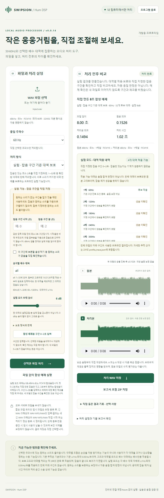

# Hum DSP

An experimental, local tool for reducing selected **50/60 Hz hum and harmonic
bands** in audio files. Compare the original and processed WAV, inspect the
processing decisions, and save the result without uploading your audio.

**Personal, noncommercial evaluation only. Commercial use and redistribution
require separate permission. This is source-available, not open source.** See
[LICENSE](LICENSE).

## Try it

### Source: Windows, Linux or macOS with Python 3.12+

Download this repository or the source archive from the
[v0.0.14 evaluation release](https://github.com/mingyeomjung-alt/hum-dsp/releases/tag/v0.0.14-evaluation).
Extract it and open a terminal in its directory. On Windows PowerShell:

```powershell
python -m venv .venv
.\.venv\Scripts\python.exe -m pip install .
.\.venv\Scripts\python.exe start_local.py
```

Or on Linux/macOS:

```sh
python3 -m venv .venv
.venv/bin/python -m pip install .
.venv/bin/python start_local.py
```

These commands invoke the environment directly; activation is not required.
The launcher
prints a local address and opens your browser. Keep the terminal open and press
Ctrl+C there to stop. Installation downloads dependencies; audio processing
itself is local. The interface is currently **Korean**; the English field guide
below explains the main controls.

### Windows portable build: not published yet

The internal Windows candidate is withheld while bundled-runtime
redistribution rights and notices are reviewed. **This public release contains
source only, not a downloadable EXE.** Separate clean-machine and code-signing
coverage are not claimed. The source quickstart above does not bundle codec or
runtime binaries; dependencies are installed separately by your package manager.
Do not disable operating-system protections to run an unverified binary.

## First run, without your own audio

1. Leave the first processing mode selected: fixed filter.
2. Choose **50 Hz** or **60 Hz**.
3. Press **파일 없이 합성 예제 실행** (run synthetic example without a file). The built-in signal is generated
   mathematically; no downloaded recording is required.
4. Use the two players manually: **A 원본** is original, **B 처리본** is processed.
   Start at a low listening volume. Playback never starts automatically.
5. Save **처리 WAV 저장** (processed WAV) or **보고서 포함 ZIP 저장** (results ZIP).

For your own file, use **WAV 파일 선택** (choose WAV) or drag it into the file
box, then press **선택한 파일 처리** (process selected file). Keep a separate copy of the original.

<details>
<summary>Preview the local interface (Korean)</summary>



</details>

## Processing modes and input limits

| Mode | Scope |
| --- | --- |
| Fixed / tracked / guarded / harmonics / manual bands | 48 kHz, mono, PCM16 WAV, up to 60 s and 32 MiB |
| General WAV | 44.1/48 kHz, mono/stereo PCM16, up to 60 s |
| Long WAV | 44.1/48 kHz, mono/stereo PCM16, up to 600 s **and** 128 MiB |
| High-resolution WAV | 44.1/48 kHz, mono/stereo PCM16/PCM24/Float32, up to 600 s **and** 128 MiB |
| Experimental profile protection | 48 kHz, mono, PCM16 WAV, up to 60 s; explicit same-file noise-only interval of at least 2 s |

The selected mode's visible limit is authoritative. Float32 must contain finite
samples in `[-1, 1)`; out-of-range input/output is rejected, not silently clipped.
WAV metadata outside the audio data is not guaranteed to survive processing.
44.1 kHz processing uses fixed resampling and can change boundaries and high
frequencies. Stereo uses one file-wide reference channel and linked settings;
hum isolated in the quieter channel may be missed. No output normalization or
dithering is applied.

MP3/AAC-M4A is an **optional source-only** feature requiring a separately
installed compatible PyAV 19.x decoder. It is not needed for the WAV demo or
tests. Codec binary distribution/patent rights are not represented as cleared;
this repository does not distribute those binaries. See
[third-party notes](docs/THIRD_PARTY.md).

## Experimental profile protection

This is an optional offline guard, **not automatic source separation**. Select
the last mode, **실험 · 잡음 구간 기준 대역 보호**, enter the start/end seconds
of a noise-only interval in the **same input file**, and explicitly confirm
that it contains no wanted audio. The tool does not assume the first 2 s are
noise and cannot verify your assertion.

Selected harmonic orders 1–32 must be supported in that interval. A whole-file
amplitude check can veto an order before the unchanged narrow-band processor is
applied. The check reads future samples: it is **not real-time or causal**.
Withheld bands remain untreated, and leaving everything unchanged is not a
denoising success. Inspect approved/rejected bands and the exported
`profile_trace.json`.

**Important failure modes:** wanted audio at the same frequency and comparable
amplitude can still be attenuated; a contaminated profile can damage wanted
content; growing noise can be deliberately left untouched. Do not use this
mode when you cannot identify a genuine noise-only interval.

## What this does not promise

- Not broadband hiss reduction, source separation, speech enhancement or spatial ANC.
- No microphone capture, real-time room cancellation or automatic playback.
- A quieter selected band is not proof of better perceived sound.
- A 12 dB setting is not a promise of 12 dB whole-file noise reduction.
- Automated tests do not prove perceptual or commercial audio quality.

Read the measured scope and failure cases in [evaluation notes](docs/EVALUATION.md).

## Local files and privacy

There is no analytics, cloud account or audio upload service. The local helper
binds to loopback and is **not a public web server**: do not expose it through
a tunnel or change it to listen on your network. Browser playback is manual.

Some modes keep temporary input/output copies for downloads until the next job
or graceful program shutdown. A crash, forced termination or power loss can
leave session files behind. This is not secure erasure. Save wanted results
before starting a new job; inspect your own session storage if you process
sensitive audio. See [security notes](SECURITY.md).

## Developer check

```text
python -m pip install -e ".[test]"
python -m pytest -q
```

Node.js is optional for executable UI-contract tests; those tests are skipped
when Node is absent. HTTP tests start only loopback listeners and do not play
or record audio. This sanitized public suite uses owned synthetic temporary
fixtures, not private recordings. Some historical research commands need
separately supplied evaluation history and are not the quickstart. See
[evaluation notes](docs/EVALUATION.md) for the included and excluded coverage.

## Feedback

Open a **Bug report / evaluation feedback** issue with your OS, version, mode,
format, settings and observed behavior. **Do not attach personal audio, names,
private paths, tokens or confidential logs.** A synthetic reproducer or a
minimal description is preferable. Public issues are public; this prototype
does not include support guarantees.
